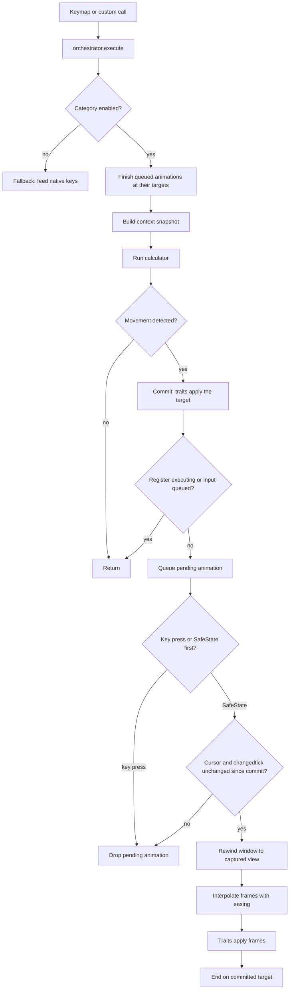
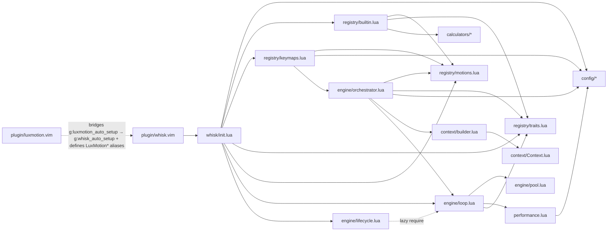

# Architecture

whisk.nvim is organized around a motion registry, a context layer that captures buffer/window state, calculators that compute target positions, and an animation engine. Every motion is applied to Neovim immediately; the animation is a replay of that movement, started once Neovim is idle.

---

## High-level flow

1. A keymap (or custom call) triggers `orchestrator.execute(motion_id, input)`.
2. The orchestrator checks if the motion's category is enabled. If not, it feeds the native keys.
3. Queued animations are finished at their targets, so the motion starts from committed state.
4. The context builder captures a snapshot of cursor, viewport, buffer state, and the full window view.
5. The motion's calculator returns a target cursor/viewport position.
6. The target is applied immediately through the motion's traits (the commit).
7. Unless a register is executing or more input is queued, the animation is queued as pending.
8. At `SafeState` the window is rewound to the captured view, and frames interpolate back to the committed target, applying easing.

---

## Module structure

```
lua/whisk/
  init.lua                    Main entry point (setup, toggles)
  config.lua                  Config facade (re-exports submodules)
  performance.lua             Performance mode and frame monitoring

  config/
    defaults.lua              Default configuration values
    validation.lua            Config validation
    management.lua            Runtime config get/update/reset (get accepts optional category key)

  registry/
    builtin.lua               Registers built-in traits and motions
    motions.lua               Motion definition store (tracks by category via internal categories table)
    traits.lua                Trait store
    keymaps.lua               Keymap installation from registry (skips categories where config is false)

  context/
    Context.lua               Context class (buffer/window snapshot + methods)
    builder.lua               Builds a hydrated context from input

  calculators/
    init.lua                  Aggregator for all calculator modules
    basic.lua                 h, j, k, l, 0, $ (direct math)
    word.lua                  w, b, e, W, B, E (native delegation)
    find.lua                  f, F, t, T (native delegation, requires char)
    text_object.lua           {, }, (, ), % (native delegation)
    line.lua                  gg, G (direct math + viewport calculation), | (direct math, cursor only)
    search.lua                n, N, gj, gk (native delegation; gj/gk are screen-line motions colocated here)
    scroll.lua                ctrl_d/u/f/b, zz/zt/zb (direct math)

  engine/
    orchestrator.lua          Motion execution: commit, animation skip, fallback
    loop.lua                  Pending/running animations, SafeState and key hooks, easing, frames
    pool.lua                  Object pool for animation tables
    lifecycle.lua             Ends animations when their buffer or window goes away

  cursor/
    keymaps.lua               Deprecated cursor motion wrappers
  scroll/
    keymaps.lua               Deprecated scroll motion wrappers

  utils/
    visual.lua                Visual mode helpers

lua/luxmotion/
  init.lua                    Deprecation shim (forwards to whisk with warning)

plugin/
  whisk.vim                   VimScript entry point (auto-setup, Whisk* commands: Enable/Disable/Toggle, EnableCursor/DisableCursor, EnableScroll/DisableScroll, PerformanceEnable/PerformanceDisable/PerformanceToggle)
  luxmotion.vim               Deprecation shim (bridges g:luxmotion_auto_setup → g:whisk_auto_setup, defines LuxMotion* command aliases)
```

---

## Runtime flow



---

## Module dependencies



Dashed lines indicate lazy `require()` calls (deferred to function call time rather than module load time). `lifecycle.lua` defers its `require("whisk.engine.loop")` to function bodies to avoid a circular dependency at load time. Although `init.lua` uses `require("whisk.performance")` inside `setup()` and `toggle_performance()`, this is not a true lazy load — `performance.lua` is already cached because `init.lua` eagerly requires `loop.lua` at module load time, and `loop.lua` eagerly requires `performance.lua`.

---

## Setup and teardown

`init.setup(user_config)` handles re-initialization: if already initialized, it calls `reset()` before proceeding. This allows users to call `setup()` multiple times (e.g., to change config at runtime) without leaking keymaps or autocmds.

`init.reset()` tears down in this order: `keymaps.clear()`, `loop.complete_all()` (while traits are still registered, so running animations can land on their targets), `traits.clear()`, `motions.clear()`, `lifecycle.teardown()`, `performance.teardown()`.

`init.setup()` reports an error and installs nothing on Neovim older than 0.10: the engine depends on the `SafeState` event and `state()`.

---

## Orchestrator

`orchestrator.execute(motion_id, input)` performs:

1. Look up the motion definition from `motions.get(motion_id)`.
2. Check category config (`cursor` or `scroll`) is enabled. If disabled, call `fallback()`, which runs `[count]<key>[char]` immediately with `:normal!` (count is only prepended when greater than 1), so keys already queued behind the motion still run after it.
3. Call `loop.complete_all()`, so every queued animation ends at its target before the new context is built.
4. Build a context snapshot via `context.builder.build(input)`.
5. Run the calculator. Exit early if there is no result, or if the result leaves both the cursor position and the viewport topline unchanged.
6. Commit: apply the result through each of the motion's traits at progress `1.0`. The cursor and view equal the target before the keymap handler returns.
7. Skip the animation when `vim.fn.reg_executing()` is non-empty or `vim.fn.state("m")` reports queued input; nothing would be drawn before the next key.
8. Otherwise queue the animation with `loop.start()`.

The commit is what keeps whisk correct under macros, `:normal`, `feedkeys()`, and code that reads the cursor right after a motion: all of them observe the target immediately. The animation only replays a movement that has already happened.

---

## Context

The context layer captures a snapshot of Neovim state and provides safe mutation methods.

### Context class (`context/Context.lua`)

Constructed via `Context.new(bufnr, winid)`. Captures buffer and window state at construction time in `self.start`: `cursor`, `topline`, `line_count`, and `view` (the window's full `winsaveview()`).

| Method | Description |
|--------|-------------|
| `is_valid()` | Returns false if buffer deleted, window closed, or buffer changed |
| `get_line_count()` | Current buffer line count |
| `get_line_length(line)` | Length of a specific line |
| `clamp_line(line)` | Clamp to valid line range |
| `clamp_column(col, line)` | Clamp to valid column range |
| `clamp_position(line, col)` | Clamp both line and column |
| `set_cursor(line, col)` | Validate, clamp, and set cursor position |
| `restore_view(topline, line, col)` | Validate, clamp, and restore viewport + cursor |
| `restore_start()` | Validate and restore the window to `start.view` (rewinds the window before a replay) |

### Context builder (`context/builder.lua`)

`build(input)` constructs a Context and populates derived fields:

- `ctx.input` — `{ char, count, direction }`
- `ctx.cursor` — `{ line, col }` (1-indexed line from the snapshot)
- `ctx.viewport` — `{ topline, height, width }`
- `ctx.buffer` — `{ line_count }`

---

## Animation engine

### Loop (`engine/loop.lua`)

The loop owns queued animations. Each one is committed before it is queued, and moves through two phases:

- **pending**: waiting for `SafeState`. `start()` records the committed cursor and the buffer's `changedtick`.
- **running**: being replayed. At `SafeState`, which Neovim fires when nothing is pending and before it redraws, a pending animation whose cursor and `changedtick` still match the commit records the current window view as its landing view, is rewound with `context:restore_start()`, and starts running; otherwise it is dropped. The landing view already includes Neovim's own adjustments (such as `'scrolloff'`) and any view change made after the commit, so landing on it reproduces the committed state exactly. Because the rewind happens before the redraw, the first painted frame shows the start position, never the target.

Two hooks exist only while the queue is non-empty and are released when it empties:

- A `vim.on_key` listener that calls `complete_all()`, so every key (typed, replayed from a register, or fed) acts on the committed target. Errors are reported through `vim.schedule` and `vim.notify` rather than raised: Neovim removes an `on_key` listener that errors or returns a value, and a message shown inside the listener can wait for input and swallow the key that interrupted the replay.
- A `SafeState` autocmd (`once = true`) that starts pending animations.

Each frame tick:

1. Records frame time via `performance.record_frame_time()`.
2. Drops running animations whose context is no longer valid, without writing.
3. Computes `progress = elapsed / duration`, clamped to `[0, 1]` (a zero duration completes immediately), applies easing, lerps cursor line/col and viewport topline, and calls `traits.apply_frame()` for each trait.
4. At `progress >= 1.0`, lands the animation (applies the committed result through the traits, then restores the landing view) and removes it. Landing errors are reported the same way as listener errors.
5. Reschedules while any animation is running. Ticks go through a single pending-tick guard, so finishing and restarting animations never stacks a second timer chain.

Every termination path (`complete_all`, `complete_for_buffer`, `complete_for_window`) lands running animations whose context is still valid and drops pending ones, which already sit at their target. If a trait fails while landing, the remaining animations still land and the first error is raised afterwards; `init.reset()` finishes its teardown before re-raising it.

Frame interval is determined by `performance.get_frame_interval()`: 16ms (~60fps) normally, 33ms (~30fps) when both performance mode is active and `reduce_frame_rate` is enabled. Durations are converted from milliseconds to nanoseconds internally (`duration * 1000000`) for use with `vim.loop.hrtime()`.

**Easing functions:** `linear`, `ease-in`, `ease-out`, `ease-in-out`.

**Loop exports:**

| Function | Description |
|----------|-------------|
| `start(options)` | Queues a committed animation as pending (`context`, `result`, `traits`, `duration`, `easing`) |
| `complete_all()` | Ends every queued animation at its committed target (next motion, key press, `init.reset()`) |
| `complete_for_buffer(bufnr)` | Ends the animations of one buffer (used by lifecycle) |
| `complete_for_window(winid)` | Ends the animations of one window (used by lifecycle) |
| `get_active_count()` | Number of queued animations, pending or running |
| `is_running()` | Whether a frame tick is scheduled |
| `force_process_frame()` | Runs a frame immediately (useful for testing) |
| `get_easing(name)` | Returns the named easing function, or `linear` for unknown names |

### Object pool (`engine/pool.lua`)

Recycles animation table allocations to reduce garbage collection pressure.

- Maximum pool size: 10 objects.
- `acquire()` returns a pooled object or allocates a new one.
- `release(animation)` resets all fields (numbers to 0, references to nil) and returns the object to the pool if under capacity.
- `get_stats()` returns `{ pool_size, max_pool_size }` for introspection.
- `clear()` empties the pool entirely.

### Lifecycle (`engine/lifecycle.lua`)

Creates a `WhiskLifecycle` augroup with three autocmds:

| Event | Action |
|-------|--------|
| `BufDelete` | End the deleted buffer's animations at their targets |
| `WinClosed` | End the closed window's animations at their targets |
| `BufLeave` | End the left buffer's animations at their targets |

**Additional lifecycle exports:**

| Function | Description |
|----------|-------------|
| `teardown()` | Deletes the `WhiskLifecycle` augroup and all its autocmds (called by `init.reset()`) |
| `is_active()` | Returns whether the lifecycle augroup is currently registered |

---

## Traits

Traits are small apply functions that know how to write an interpolated frame to Neovim:

- **cursor** trait calls `context:set_cursor(line, col)`.
- **scroll** trait calls `context:restore_view(topline, line, col)`.

The same `apply` function writes the commit (progress `1.0`), every replay frame, and the final landing, so a trait only has to know how to put one result on screen.

Trait definitions (stored in the traits registry) accept `on_start` and `on_complete` hooks alongside the `apply` function. The registry stores them; the engine does not call them.

`clear()` removes all trait definitions (used by `init.reset()`).

---

## Calculators

Calculators receive a context and return a target:

```lua
{
  cursor = { line = ..., col = ... },
  viewport = { topline = ... },
}
```

Two calculation strategies:

- **Direct math** — basic, line, and scroll calculators compute targets arithmetically from context values.
- **Native delegation** — word, find, search (including screen-line motions gj/gk), and text object calculators execute `normal!` motions to find the accurate target, then restore the cursor before returning the result. Note: `gj`/`gk` are colocated in `search.lua` for implementation convenience, but their motion IDs use a `screen_` prefix (`screen_gj`, `screen_gk`) and are registered under the `cursor` category.

---

## Performance mode

When enabled, performance mode:

- Conditionally disables syntax highlighting (`vim.bo.syntax = "off"`, restored on disable) when `disable_syntax_during_scroll` is set.
- Reduces frame rate from 60fps to 30fps when both performance mode is active **and** `reduce_frame_rate` is set.
- Populates a passive lookup table of ignored events (default: `WinScrolled`, `CursorMoved`, `CursorMovedI`). Callers check `should_ignore_event(event)` to decide whether to skip logic — no autocmds are registered to intercept events.
- Auto-toggles on `BufEnter`/`BufWinEnter` via `auto_toggle()`: enables when `performance.enabled` is `true` in config, or when `auto_enable_on_large_files` is `true` and the buffer exceeds `large_file_threshold` lines; disables otherwise.
- Maintains a rolling window of the last 10 frame times for FPS calculation.
- Exposes `get_frame_interval()` and `get_current_fps()` for introspection.

Note: `frame_rate_threshold` is defined in defaults (`60`) but is not currently read by any code path. It exists as a placeholder for future use.

---

## Extension points

- **Custom keymaps** — call `orchestrator.execute()` directly with any registered motion ID, or use `require("whisk.registry.keymaps").create_handler(motion)` to generate a keymap handler function that reads `vim.v.count1` and collects char input automatically.
- **Custom motions** — register via `require("whisk.registry.motions").register()`. `modes` defaults to `{ "n", "x" }`; any other mode raises an error, because `"v"` also maps Select mode and animations are meaningless in Operator-pending mode.
- **Custom traits** — register via `require("whisk.registry.traits").register()`.
- **Selective built-in registration** — `require("whisk.registry.builtin")` exposes `register_all()`, `register_traits()`, and `register_motions()` separately.
- Built-in motions and traits are registered through `registry/builtin.lua` during setup.

---

## Testing

whisk.nvim has two dependency-free test tiers:

- **Unit** (`tests/`, run with `bash scripts/run_tests.sh`): plain Lua against a mocked `vim` table (`tests/mocks/`). Fast and hermetic; it covers wiring, config, the registries, and the engine's state machine, with `SafeState`, `vim.on_key`, and timers driven by the mocks. It cannot reproduce Neovim's input loop.
- **Integration** (`tests/nvim/`, run with `bash scripts/run_nvim_tests.sh`): real headless Neovim (`nvim --headless --clean -u tests/nvim/init.lua`). `tests/nvim/harness.lua` runs each test as a coroutine inside Neovim's main loop: `input(keys)` sends keys through `nvim_input` and resumes after Neovim has processed them (and fired `SafeState`), while `sleep` and `wait_until` poll with timers. `vim.wait` is not used, because it never reaches `SafeState`. Specs are discovered by glob from `tests/nvim/specs/`. Set `NVIM=/path/to/nvim` to run against another binary. A spec must leave Neovim idle after each `input()` (no pending operator, prefix key, or `getcharstr()` wait); a run that stops responding is killed after `WHISK_NVIM_TEST_TIMEOUT` seconds (default 300) and reported as a failure.
